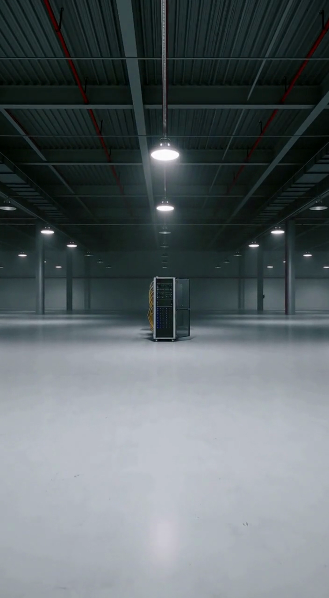
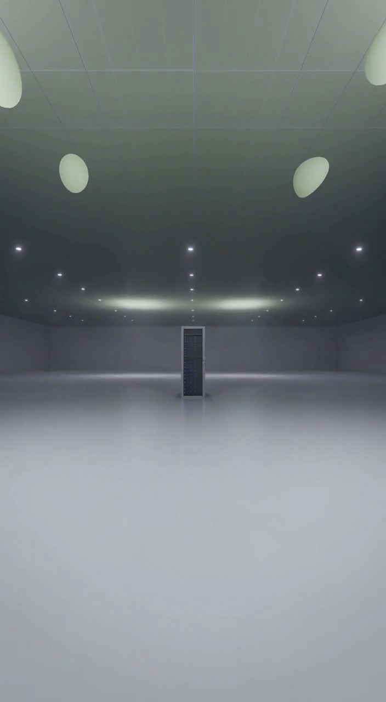
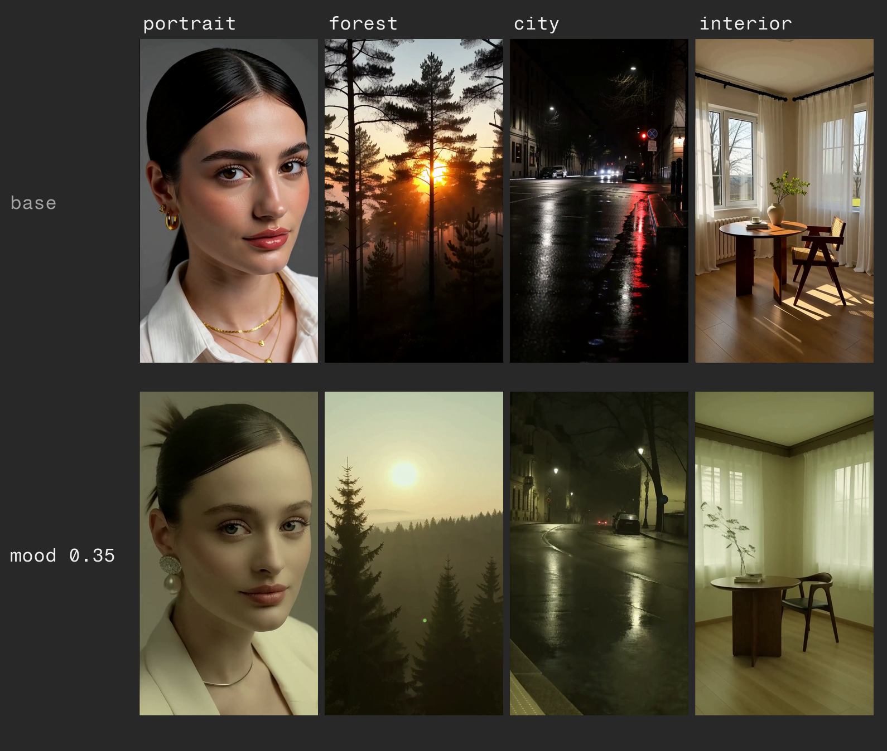
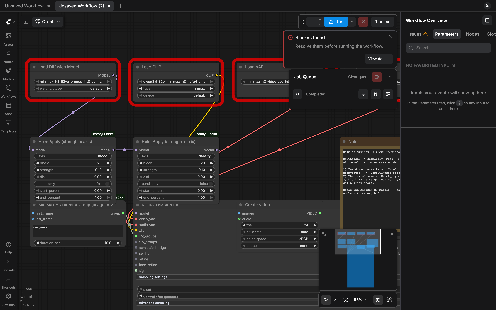
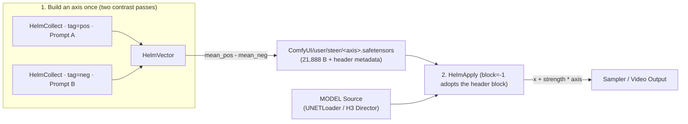
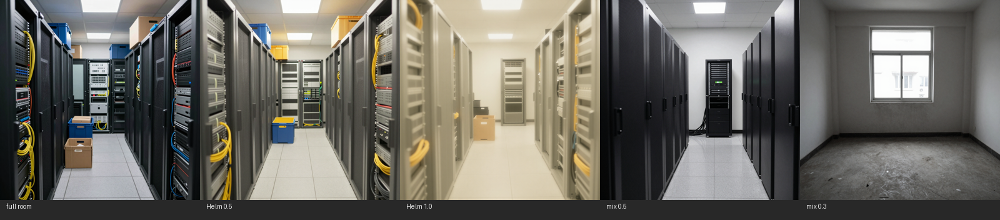

<div align="center">

# H E L M (`comfyui-helm`)

### **A prompt is a switch, not a dial. Helm gives you the dial.**

In practice, a prompt can't do "a little": change one word and the whole frame changes; lengthen the prompt and it leaks into the scene; mix two prompts and the room stays packed until the scene flips (the fair benchmark below). Helm reads a direction the model already knows and injects it with one scalar: same framing, graded, no training. **Steer what it knows. Train what it doesn't.**

**Training-free activation steering for ComfyUI & the Comfy Developer Platform.**
Extract a latent direction from two contrast passes into a **small `.safetensors` file** (the shipped `density` axis is 21,888 B, ~22 KB). Steer video and image DiTs with a single scalar. **Zero training. Zero weight modification. MIT-licensed.**

[](https://www.python.org/downloads/)
[](LICENSE)
[](#how-it-works)
[](docs/HARDENING.md)

[**Quickstart**](#quickstart-60-seconds) · [**How It Works**](#how-it-works) · [**Comfy SDK App**](#run-as-an-app-via-the-comfy-sdk) · [**Experiments (78 Axes)**](docs/EXPERIMENTS.md) · [**Roadmap**](docs/ROADMAP.md) · [**Hardening Log**](docs/HARDENING.md)

</div>

---

<p align="center">
  <a href="https://youtu.be/MxisBKxoDSQ">
    
  </a>
  <br/>
  <sub><b>▶ Watch the 47s demo</b> — same prompt, same seed, one number changed.</sub>
</p>

## Same Prompt. Same Seed. One Number Changed.

Move a single slider during sampling and shift the scene along an internal direction the model already knows. On the measured H3 `density` pair the change is in the content while the room's floor line and ceiling stay put (the caption below is the honest version). **Identity and lighting preservation are not yet measured** — see [Limitations](#limitations).

| **`strength = 0.00` (Baseline — identical to the un-steered run)** | **`strength = 0.25` (`density` axis at Block 20)** |
| :---: | :---: |
|  |  |
| *MiniMax H3 (video, 10 s): A corridor of glass server racks.* | *Same prompt, same seed: The racks leave the room; ceiling & floor geometry hold.* |

### One Axis. Any Scene.

An axis is not tied to the prompt that created it. Capture a `mood` or `density` direction once (~22 KB or less as a `.safetensors` file), and dial it into portraits, landscapes, night exteriors, or architectural shots:

<p align="center">
  
</p>

<p align="center">
  
</p>

---

## Why Helm?

Higgsfield put cinematic look and set controls behind a closed cloud studio. **Helm brings deterministic, training-free look & set steering directly into ComfyUI on open weights:**

- **A small file, not a LoRA or checkpoint:** Show the model two contrast examples (two prompts or two images). Helm records the difference in internal transformer activations (`axis = mean_pos - mean_neg`) and saves a self-describing `.safetensors` file.
- **Byte-exact zero point:** Set `strength = 0.0` and Helm contributes nothing to the sampled state. Model weights are never touched.
- **Stackable & Clamped (`0 → 1 dial`):** Chain multiple `HelmApply` nodes (`mood` → `density`) on the same model patcher. Built-in `safe_max` clamping and a normalized `0.0–1.0` `dial` keep users inside the verified band.
- **Engineered for real DiT runtimes:** Automatically bypasses MiniMax H3's `aimdo` per-block memory compiler during hook execution, enforces visual-stream tuple safety on dual-stream architectures, and runs both interactively in ComfyUI and headlessly via the **Comfy SDK**.

---

## Quickstart (60 Seconds)

### 1. Install in ComfyUI

```bash
cd ComfyUI/custom_nodes
git clone https://github.com/U-N-B-R-A-N-D-E-D/comfyui-helm.git comfyui-helm
```

Restart ComfyUI. **Prebuilt axes (`mood.safetensors`, `density.safetensors`) ship inside `example_axes/`** and resolve automatically on a fresh clone — note both were captured on **MiniMax H3** (block 20, dim 5376); they are not Z-Image axes.

### 2. Open a Template & Steer

Open ComfyUI's **Templates** browser, search **`helm`** (or drag a workflow from `example_workflows/` onto the canvas):

**What each path actually needs — no hidden steps:**

| Path | Nodes | Models | Hardware |
| :--- | :--- | :--- | :--- |
| **Z-Image** (`z_image_helm.json`) | core ComfyUI nodes only | Z-Image / Lumina2 weights | runs on a consumer GPU |
| **MiniMax H3** (`h3_*.json`) | **+ `MiniMaxH3Director` (third-party node pack)** | H3 UNet (~21 GB int8) + Qwen3-VL 32B text encoder | the int8 UNet does **not** fit in 24 GB |

`mood.safetensors` and `density.safetensors` are H3 axes (block 20, dim 5376). A **Z-Image axis ships too**: `z_room_density.safetensors` (block 15, dim 3840) — point the Z-Image template at it, or build your own (`HelmCollect` ×2 → `HelmVector`, ~1 min).

| Workflow | Model | What It Does |
| :--- | :--- | :--- |
| **`h3_t2v_helm.json`** | **MiniMax H3** (Video) | **The flagship app:** Type a prompt, move the `mood` & `density` sliders, hit Queue. |
| **`h3_i2v_helm.json`** | **MiniMax H3** (I2V) | Image-to-video generation with live activation steering. |
| **`z_image_helm.json`** | **Z-Image / Lumina2** | Steer image generation across verified layers 9–21. |
| **`krea2_helm.json`** | **Krea2** | Image generation with `HelmApply` wired between LoRA loader and sampler. *(Template wired; not yet execution-validated.)* |
| **`krea2_helm_collect.json`** | **Krea2** | Two-pass collection graph to build a custom axis from text contrast. *(Template wired; not yet execution-validated.)* |
| **`krea2_helm_image_axis.json`** | **Krea2** (Img2Img) | Extract an axis directly from two contrast images — no contrast prompt needed. *(Template wired; not yet execution-validated.)* |
| **`helm_vector.json`** | *Model-agnostic* | `HelmVector → PreviewAny`: subtract two collected tags into a reusable `.safetensors` axis. |
| **`ltx_t2v_helm.json`** | **LTX-2.3** (Video) | Official LTX blueprint wired with `HelmApply` (structural hook ready; `tested: false`). |
| **`api/h3_t2v_helm_api.json`** | **Comfy SDK / API** | API-format workflow driven by `app/run_helm.py`. |

Measured with Helm: MiniMax H3 t2v (`mood`, `density`) and Z-Image. The models used for generation elsewhere (Krea 2 stills, Qwen Image Edit, LTX/Flux tests) are **not** Helm-measured: Krea 2 templates are wired without a calibration entry, LTX ships `tested: false`, Qwen-Image/SD3 are refused by the tuple guard until declared/measured, and Flux is declared but has no dose. No Helm claim rests on them.

---

## How It Works



### The Node Suite (Category: `Helm`)

1. **`HelmCollect` (`MODEL → MODEL`):** Hooks `diffusion_model.<blocks>[K]`, accumulates the mean activation across sampling steps, and writes `ComfyUI/user/steer/<tag>.safetensors` once per run. Includes `cond_only` to isolate conditional batch items.
2. **`HelmVector` (`tags → STRING`):** Computes `axis = mean_pos - mean_neg` and saves a self-describing `.safetensors` axis with its `dim`, `block`, `model`, `module`, `norm`, and optional `safe_max` embedded in the header.
3. **`HelmApply` (`MODEL → MODEL`):** Injects `x + strength * axis` at block K during sampling. `block = -1` adopts the block recorded inside the header; `dial` (0.0–1.0) scales inside `safe_max`; `start_percent`/`end_percent` window the injection; chained nodes compose. Optional: `mode` — `push` (published), `norm` (rescale each token to its original norm) or `clamp` (move the projection inside a `clamp_k`·‖x‖ budget); `mask` + `layout` (`h_w`, `t_h_w`, `h_w_t`) + `grid` (`H,W[,T]`) + `mask_offset` (leading packed rows to skip) for a regional application. `mask_offset` is required when the model packs extra rows before the visual tokens: Z-Image has 32 rows before its 4096 spatial tokens (`grid=64,64`, `mask_offset=32`), and H3 packs `[text|cond|audio|video]`, so the offset is the row count before the video slice. The mask is refused unless `mask_offset + grid tokens == block sequence`. Every run logs the block shape once (`[helm] shape debug: ...`) so the token layout is discovered, never guessed.
4. **`HelmProbe` (`MODEL → MODEL`):** Profiles an uncalibrated model by recording activations across **every** transformer block simultaneously in one pass. Run it twice — tag `probe_pos` with the first prompt, `probe_neg` with the contrasting one — then feed both tags to `HelmProbeReport`.
5. **`HelmProbeReport` (`tags → INT`):** Per-block separation ranking, writes `ComfyUI/user/steer/probe_report.json`, outputs the middle-band peak block as a starting point for calibration — a measurement, not a validated block picker.

---

## Run as an App via the Comfy SDK

`app/run_helm.py` drives Helm workflows programmatically through the **Comfy Developer Platform (`comfy-sdk`)**. The same command runs against a local ComfyUI instance (behind `comfy-api-proxy`) or **your own** hosted/serverless deployment — only `COMFY_BASE_URL` (and an API key) change. It does **not** run on Comfy Cloud: Cloud does not allow installing custom nodes, so Helm cannot be present there.

```bash
pip install comfy-sdk comfy-api-proxy
comfy-api-proxy                                   # Serves Comfy API v2 on 127.0.0.1:8189 in front of ComfyUI :8188
export COMFY_BASE_URL=http://127.0.0.1:8189

python app/run_helm.py --list                     # Inspect available Helm sliders in the workflow
python app/run_helm.py --set mood=0.15 --set density=0.25 --out out
```

Your own hosted / serverless deployment:

```bash
export COMFY_BASE_URL=https://<deployment>.run.comfy.app
export COMFY_API_KEY=comfyui-...
python app/run_helm.py --workflow api/h3_t2v_helm_api.json --strength 0.2 --out out
```

Per-node control: `--workflow` selects the graph (default `api/h3_t2v_helm_api.json`), `--strength` is the global default, `--axis` overrides axis names, and a repeatable `--set AXIS=STRENGTH` targets individual `HelmApply` nodes; `--list` prints every node in graph order.

---

## Prior Art & What Is New Here

Activation steering for diffusion is not new, and we say so:

- **CASteer** (Gaintseva et al., ICLR 2026, [arXiv:2503.09630](https://arxiv.org/abs/2503.09630)) — training-free steering vectors built by averaging cross-attention activations, for concept erasure in image diffusion.
- **Concept Sliders** (Gandikota et al., ECCV 2024, [arXiv:2311.12092](https://arxiv.org/abs/2311.12092)) — interpretable sliders, but each one is a trained LoRA adaptor.

What Helm adds is deliberately narrow and testable: **no training and no adapter** (a ~22 KB safetensors direction built from two passes at inference time), **on a video DiT** (MiniMax H3, not an image UNet), **inside ComfyUI** as a node pack with per-block calibration, a `safe_max` clamp and self-describing axes, and **published negative results** (the 78-axis sweep and the refuted predictor). We ran that comparison (fair design: both methods from the same starting prompt) — see §4 and `docs/EXPERIMENTS.md` §E. The mix is a scene switch; Helm is a graded change at the same framing.

## Measured Science (Not Vibes)

**In one line:** 78 captured, 55 dosed, **53 labelled**; **10/53** hold under the pre-registered criterion and **7/53** with the post-hoc ceiling — the video's **7-10 of 53**.

### 1. Monotonic Dose-Response & Seed Replication


On MiniMax H3 (block 20, dim 5376), sweeping the `density` axis moves `CLIP P(empty room)` from **0.067 → 0.980** by strength 0.30, with edge density falling **0.007 → 0.003** — saturation and edge density fall monotonically while the CLIP score climbs, and the effect reproduces across seeds (seed 23 at 0.30 reads 0.990 vs seed 11's 0.980). Full table, with the honest caveats about the CLIP probe's high-strength confound: [`docs/EXPERIMENTS.md` §A](docs/EXPERIMENTS.md#a-dose-response-density-axis).

### 2. Direction vs. Magnitude Control (Orthogonality Check)

At the same `strength = 0.30`, the `density` axis **drains** saturation (HSV sat **0.073**) while a hue-only axis — same composition, differing only in hue — **inflates** it (**0.917**) and preserves edges (edge density **0.009 vs 0.003**). The two directions push different, specific properties: the effect is directional, not a generic magnitude wash. [`docs/EXPERIMENTS.md` §B](docs/EXPERIMENTS.md#b-is-it-a-direction-or-just-magnitude-hue-control).


### 3. Cross-Architecture Reproduction & 78-Axis Stress Test

- **Same contrast in a second architecture** (Z-Image / Lumina2, layers 9–21 of 30): the identical empty-vs-packed contrast reproduces monotonic content removal — edge density **0.018 → 0.001**. A "density" direction is not unique to H3's architecture; this is a same-effect result in two models, **not** vector transfer. [`docs/EXPERIMENTS.md` §C](docs/EXPERIMENTS.md#c-the-same-contrast-in-a-second-model-partial).
- **78 directions measured on Z-Image — and killing our own predictor:** Of 78 captured directions, 55 were dosed and 53 labelled. Under the pre-registered criterion, **10 of 53** hold in `push` (43 wash, 2 unmeasured); a post-hoc ceiling (saturation <= 0.5 and edge <= 2x baseline) leaves **7 of 53**. The earlier "1 in 3" was a coarse summary and is superseded by the 2026-10-19 labels. The lowest survivor sits at **0.31** cosine alignment while a washed-out axis sits at **0.94** (cosine, not a separation score). At n=23 axes, cosine alignment with the mean activation appeared to predict usable axes perfectly. We scaled the test to n=78, watched the separation collapse, and **killed our own predictor hypothesis** rather than shipping a false filter — the numbers stay, the story goes. The table is in the repo: [`docs/data/zimage-78-axes.json`](docs/data/zimage-78-axes.json) (one row per axis: norm, cosine, and whether it was dosed) and [`docs/data/zimage-dose-response.json`](docs/data/zimage-dose-response.json) (163 dose points covering 55 of the 78 — the other 23 remain unmeasured).

### 4. Not a Prompt Mixer (Measured, Fair Design)



Both methods start from the **same full-room prompt** and move toward empty (Z-Image-Turbo, block 15,
seed 11; seed 23 replicates). At 0.5 Helm keeps the framing and grades it (luminance 0.317 → 0.472,
edge 0.0266 → 0.0209); `ConditioningAverage` between 0.9 and 0.7 is visually a no-op and only flips the
scene at 0.3 (P(empty) 0.998). The mix replaces the scene; Helm is a graded control at the same prompt.
Full table and caveats: [`docs/EXPERIMENTS.md` §E](docs/EXPERIMENTS.md#e-helm-vs-prompt-mixing-conditioningaverage--fair-re-test-2026-10-19);
raw numbers: [`docs/data/bench2-vs-prompt-mix.json`](docs/data/bench2-vs-prompt-mix.json).

### Calibration Table (`calibration.json`)

| Model | Module | Blocks | Hidden dim | Default block | Verified band | Usable strength | Axis norm |
| :--- | :--- | ---: | ---: | ---: | :--- | :--- | :--- |
| **MiniMax H3** | `blocks` | 50 | 5376 | 20 | 15–35 | 0.01–0.30 | ~3000–4000 |
| **Z-Image / Lumina2** | `layers` | 30 | 3840 | 15 | 9–21 | 0.50–3.00 | ~19 |
| **LTX-2.3** | `transformer_blocks` | — | — | 20 | — | — | — |

The shipped H3 axes record `safe_max: 0.3`; the shipped Z-Image room-density axis records **0.25** (its wash is visible at 0.5). `HelmApply` clamps any strength past the recorded `safe_max`. LTX-2.3 ships flag-wrapped defaults with `tested: false` — module `transformer_blocks` is wired, the numbers are H3-derived placeholders pending a sweep. Axis scale is model-specific; confirm every model with 1–2 renders. The Z-Image band is not a law: on the §E benchmark axis the wash is already visible at 0.5, so check the wash onset per axis.

---

## Limitations

- **Two models measured *with Helm*.** H3 (t2v) and Z-Image — that is where an axis, a band and a dose were measured. The models used for generation elsewhere are **not** Helm-measured: Krea 2 (templates wired, no calibration entry), LTX-2.3 (`tested: false`), Flux (tuple slot declared, no dose), Qwen-Image/SD3 (tuple `(txt, img)` refused until declared/measured). No Helm claim rests on them.
- **The axes are low-level directions, not concepts.** Pushed far enough they wash the frame out; the wash is the signature of leaving the model's manifold, not a feature.
- **One baseline measured.** Helm vs prompt-only (`ConditioningAverage`) is measured in §4 / `docs/EXPERIMENTS.md` §E (one model, one contrast pair, two seeds). A **LoRA baseline is not measured**.
- **The pre-registered criterion has no upper bound on saturation or edge density.** A post-hoc ceiling (saturation <= 0.5, edge <= 2x baseline) leaves **7/53** push holds; the 3 primary survivors it excludes are the saturated/specular axes at their top dose (`z_saturated_vs_muted_stock`, `z_specular_reflection_density`, `z_specular_reflection_intensity`). The primary labels are unchanged; `strict_push` is in `docs/data/axis-labels.json`.
- **Norm-preserving and projection-clamping did not help (measured).** On the 55-axis bench with a pre-registered criterion, `push` holds 10/53 axes, `norm` 1/53 and `clamp` 2/53: both alternatives collapse luminance instead of removing the wash. The step window is a partial mitigation, not a fix. Details: `docs/EXPERIMENTS.md` §F.
- **What is measured is content and geometry proxies** (CLIP empty-room score, saturation, edge density) on one contrast pair per model. Subject identity, camera movement and lighting are **not** measured.
- **Regional masks localize the injection, not the visible effect.** The delta is zero outside the mask (unit-tested), but attention propagates the edit: in the 2026-10-19 Z-Image demos >98% of outside pixels still moved (inside/outside mean |difference| ratio 1.4-1.7). Do not read `mask` as spatial containment.
- **Axis scale is model-specific.** The H3 wash-out onset (~0.45 at axis norm ~3000) is not comparable to the Z-Image band (norm ~19), which is why the calibration table lists them separately.
- **Custom nodes only.** Comfy Cloud does not install custom nodes, so Helm runs on local or self-hosted ComfyUI.
- **A shipped artifact has broken once.** Commit `3003fc8` replaced `example_axes/mood.safetensors` with a 6-value unit-test stub (the H3 template then failed on a dimension mismatch). It is restored, `tests/test_example_axes.py` now validates every shipped axis, and `tests/conftest.py` fails the suite if anything writes into `example_axes/`.

## Architecture & Stream Map

Where `HelmApply` injects into a block's output changes by architecture — some blocks return plain tensors, some return tuples where the element order is not standard:

| Architecture | Block Attribute | Block Output | Visual Stream Slot | Status in Helm |
| :--- | :--- | :--- | :--- | :--- |
| **MiniMax H3** | `blocks` | `Tensor` (packed sequence) | — | **Calibrated & Verified** |
| **Z-Image / Lumina2** | `layers` | `Tensor` | — | **Calibrated & Verified** |
| **LTX-2.3** | `transformer_blocks` | `Tensor` | — | Hook ready (`tested: false`) |
| **Flux** (`DoubleStreamBlock`) | `double_blocks` | `Tuple (img, txt)` | Element `0` | Declared in `_TUPLE_VISUAL_BY_CLASS` |
| **SD3** | `joint_blocks` | `Tuple (txt, img)` | Element `1` | Refused until measured |
| **Qwen-Image** | `transformer_blocks` | `Tuple (txt, img)` | Element `1` | Refused until measured |

**Zero silent guessing:** an undeclared tuple block raises an explicit `RuntimeError` naming the class, rather than steering the text conditioning (SD3 and Qwen-Image would do exactly that if guessed as `out[0]`). `_BLOCK_ATTRS` and `_TUPLE_VISUAL_BY_CLASS` in `nodes.py` are where an architecture gets declared; the refusal error lists every block attribute actually present on the module.

---

## Engineering Notes & Hardening

- **Self-contained `.safetensors` axes (No Pickle)** — header metadata (`dim`, `block`, `model`, `module`, `norm`, `safe_max`); the legacy `.pt` read path is kept for 0.2.0 axes and loads strictly with `weights_only=True`.
- **Resolution order without metadata shadowing** — `user/steer` → `models/steer` → `example_axes/` (preferring `.safetensors` over a legacy `.pt` in the same directory); metadata comes strictly from the axis's own `.safetensors` header or sidecar, so a bundled axis never shadows a user's file. A missing axis raises a `FileNotFoundError` listing every directory searched.
- **MiniMax H3 `aimdo` bypass** — `aimdo_enabled = False` strictly for the wrapped call, restored in the `finally` block along with hook removal.
- **62 automated tests** — silent-failure modes pinned; the full defect log is [`docs/HARDENING.md`](docs/HARDENING.md).

```bash
curl -s http://127.0.0.1:8188/object_info | grep -o 'Helm[A-Za-z]*' | sort -u
# HelmApply
# HelmCollect
# HelmProbe
# HelmProbeReport
# HelmVector
```

---

## Licensing & Credits

| Component | License |
| :--- | :--- |
| **`comfyui-helm`** (nodes, SDK runner, example workflows, prebuilt axes) | [**MIT License**](LICENSE) |
| **Model weights (H3, Z-Image, LTX, Krea2, Flux)** | Governed by their respective licenses; no weights bundled |

Built by **[ U N B R A N D E D ]** for the [ComfyUI](https://github.com/comfyanonymous/ComfyUI) community.

## Related (public)

- [`comfy-api-graphs`](https://github.com/U-N-B-R-A-N-D-E-D/comfy-api-graphs) — zero-dependency Python helper to load, mutate and validate ComfyUI API-format graphs.
