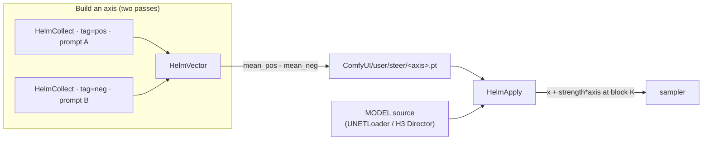

# Helm (`comfyui-helm`)

[](https://www.python.org/downloads/)
[](https://opensource.org/licenses/MIT)

**A slider for the model's own ideas.** Helm is an open-source *look control* for ComfyUI — the kind of control Higgsfield put behind Cinema Studio — rebuilt on open weights, by **[ U N B R A N D E D ]**.

## The idea, in plain terms

An image or video model doesn't produce the final frame all at once. It starts from noise and refines it, step by step. Somewhere inside that process is a direction that roughly means "brighter", another that means "emptier", another that means "more saturated".

Helm finds one of those directions and hands you a **single slider** for it. Move the slider while the model runs, and the whole scene shifts along that direction — same prompt, same seed, same model, just more or less of that one quality.

Setting it up is small and one-time. You show the model **two contrast examples** — say, a bright scene and a dark one, as two prompts or two images — and Helm records how the model's internal state differs between them. That difference is a small file (about **20 KB**), which we call an **axis**. From then on, that file is your slider. Nothing is trained, and nothing inside the model changes.

## What it is, and what it is not

- **It's a steering knob, not a new model.** No training, no merge, no checkpoint. Set `strength` to `0` and Helm does literally nothing — the output is byte-for-byte identical to the un-steered run.
- **It's not a LoRA, a fine-tune, or a clever prompt.** Those change *what the model looks at*. Helm changes *how much of one direction* the model applies.
- **It's not unlimited.** Push the slider past a model-specific range and the frame washes out. That's the cost of pushing the model off its natural path — not something we can tune away (see [Limitations](#limitations)).

## What you get, and what to expect

- **Works today on** MiniMax H3 (video) and Z-Image (image); example graphs for Krea2 and LTX ship too. Other models are untested.
- **The axes we've found so far are simple qualities** — light, mood, density. Vague, "vibe"-level directions ("make it look vintage") aren't proven yet.
- **You bring the model weights.** Helm is tiny; it bundles none.
- **It plugs into however you run ComfyUI.** Install it as a normal custom-node pack for the desktop editor, or run the same workflow from a script through the Comfy SDK (`app/run_helm.py`).
- **It's measured, not asserted.** The dose-response and the direction-vs-magnitude control, with honest caveats, are in [`docs/EXPERIMENTS.md`](docs/EXPERIMENTS.md).

## Why this is different

Prompting and LoRAs change what the model attends to. Helm reaches one level lower — into the model's own internal state — and puts a slider on it.

- **A direction, not a model.** An axis is the difference between two recorded internal states: a ~20 KB file, nothing to train.
- **One number to steer.** A single `strength` value scales the direction. `0` means no change; the weights are never touched.
- **Portable and stackable.** Axes are just files. Share one, name one, chain several together.

### Where this can go

Helm isn't a new kind of model, and it isn't a replacement for LoRA or prompting — those *teach* a model things; a direction *moves* it along something it already knows. What it is, more precisely, is a cheap **instrument**: two passes to *measure* a direction, one scalar to *move* along it, and a few kilobytes to *keep* it.

That makes the interesting questions open rather than answered:

- **Do directions transfer?** An axis is tied to one model's width. Whether the *same* direction can be carried across models is the question that decides whether this becomes a road or stays a per-model trick.
- **Can directions be found, not written?** Today you supply two contrast examples. The richer version reads directions out of a dataset.
- **Do they compose?** Several independent axes = a small control surface for a model's own qualities, rather than a single look.

The axes here (density, mood) are low-level and measured. The harder claims are not yet made.

## Architecture



| Path | Role |
|------|------|
| `nodes.py` | `HelmCollect` / `HelmVector` / `HelmApply` (category `Helm`) |
| `calibration.json` | Per-model defaults: module, block, strength band, axis norm |
| `example_workflows/` | Loadable UI graphs (H3, Krea2) + one API-format graph |
| `app/run_helm.py` | Runner for the Comfy SDK |
| `docs/images/` | Evidence figures (dose-response, axis vs magnitude, sweeps) + the demo |

## Nodes

- `HelmCollect` (MODEL → MODEL): hooks `diffusion_model.blocks[K]`, accumulates the mean activation over the steps, writes `ComfyUI/user/steer/<tag>.pt` once per run. Run once per prompt. New widget: `cond_only` (default `False`).
- `HelmVector` (tags → STRING): `axis = mean_pos - mean_neg` → `ComfyUI/user/steer/<name>.pt` (reusable).
- `HelmApply` (MODEL → MODEL): hooks block K, injects `x + strength * axis` while sampling. Chain several for multiple axes. New widgets appended after the existing ones: `cond_only` (default `False`), `start_percent` (default `0.0`), `end_percent` (default `1.0`).

The new widgets are appended after the existing ones, so saved graphs keep their meaning. The defaults preserve the measured result; `cond_only` and the `start_percent`/`end_percent` windowing are implemented but **not yet measured** (see [`docs/EXPERIMENTS.md`](docs/EXPERIMENTS.md)).

Wire `MODEL source → HelmApply → sampler`. Also works with H3's `MiniMaxH3Director`.

## Examples

These ship in `example_workflows/`, so ComfyUI lists them in the **Templates** browser
under the `comfyui-helm` pack (search "helm"), and they open directly (each carries a
`Note` explaining the wiring). You can also open them from the Workflows sidebar or by
dragging the file onto the canvas.

| File | What it is |
|------|------------|
| `h3_t2v_helm.json` | MiniMax H3 text-to-video with two Helm sliders (`mood`, `density`) |
| `helm_vector.json` | `HelmVector → PreviewAny`: turn two collected tags into a named axis |
| `krea2_helm.json` | Krea2 image graph with `HelmApply` between the LoRA loader and the sampler |
| `krea2_helm_collect.json` | The same Krea2 graph with `HelmCollect`, to build an axis |
| `krea2_helm_image_axis.json` | Image-defined axis: collect from two images (img2img), no contrast prompt |
| `ltx_t2v_helm.json` | LTX text-to-video (official blueprint) with `HelmApply` — **untested** (see `calibration.json`) |
| `api/h3_t2v_helm_api.json` | API-format graph, for the SDK / Comfy API (`app/run_helm.py`) |

## Run it as an app

`h3_t2v_helm.json` **is** the app: open it, type a prompt into the Director, move the `mood` / `density` sliders, Queue. Two sliders and a prompt — that is the whole interface.

Prebuilt axes ship in `example_axes/` (`mood.pt`, `density.pt`) so you can steer immediately, without the two collection passes. Axis reads search `ComfyUI/user/steer/` → `ComfyUI/models/steer/` → the pack's own `example_axes/`, so they work on a fresh clone with no copying.

For automation, and for the **Comfy Developer Platform**, `app/run_helm.py` runs the same graph through the **Comfy SDK** (see [Run via the Comfy SDK](#run-via-the-comfy-sdk)).

## Build an axis, then apply

An axis comes from two contrastive passes at the same block:

1. `HelmCollect`, tag `pos`, run with your first prompt.
2. Same node, tag `neg`, run with a contrasting prompt.
3. `HelmVector` (`pos`, `neg` → axis) → `ComfyUI/user/steer/axis.pt`.
4. `HelmApply` with `axis=axis`, block 20, strength 0.1; sweep `strength` (see `calibration.json`).

## Calibration

`calibration.json` holds per-model defaults. Axis scale is model-specific; confirm with 1–2 renders.

| Model | module | blocks | dim | block | strength | axis norm |
|-------|--------|--------|-----|-------|----------|-----------|
| MiniMax H3 | `blocks` | 50 | 5376 | 20 | 0.01–0.3 | ~2600–4000 |
| Z-Image / Lumina | `layers` | 30 | 3840 | 15 | 0.5–3 | ~19 |

Outside the band the frame degrades.

## Notes / gotchas

- **Axis storage.** Axis writes go to `ComfyUI/user/steer/` (with the `.json` sidecar beside them). Reads search, in order, `ComfyUI/user/steer/` → `ComfyUI/models/steer/` → the pack's own `example_axes/`, so the bundled `mood.pt`/`density.pt` resolve on a fresh clone. A missing axis raises a `FileNotFoundError` listing every directory searched.
- **Aimdo.** H3's per-block prefetch raises `aimdo memory compile error` when a block's output is modified. The nodes set `comfy.memory_management.aimdo_enabled = False` for the wrapped call and restore it after.
- **Wrapper contract.** ComfyUI calls `model_function_wrapper(apply_model, {"input","timestep","c","cond_or_uncond"})`; the forward hook is installed only for that call and removed after.
- **H3 does not sample with `comfy.sample.sample`** — it samples inside `MiniMaxH3Director`; the nodes hook the MODEL the Director receives.
- Restart ComfyUI after install (custom nodes load at startup).
- **Hardening log.** The six defects fixed in 0.2.0 (silent slider drops, fresh-clone crash, block discovery, sidecar metadata, calibration wiring, per-slider strengths) are documented symptom → cause → fix → test in [`docs/HARDENING.md`](docs/HARDENING.md).

## Measured

The `density` axis on H3 (block 20, dim 5376), swept `0.00 → 0.30` — a corridor of glass racks empties into a bare room, geometry intact (`docs/images/density_sweep.png`).

| Axis | Block | Effect in band |
|------|-------|----------------|
| `density` | 20 | Removes content (racks → empty room) |
| `mood` | 20 | Tone / brightness shift |

Three quantified checks live in [`docs/EXPERIMENTS.md`](docs/EXPERIMENTS.md):

- **Dose-response** — CLIP `P(empty room)` climbs `0.07 → ~1.0` as `strength` rises, with saturation and edge density falling monotonically; reproduced on a second seed. `docs/images/dose_response.png`
- **Direction vs magnitude** — a *hue* axis at the same strength does the opposite thing (saturation up to 0.92, content preserved), so the effect is directional, not a generic wash. `docs/images/axis_vs_magnitude.png`
- **A second model** — the same *empty vs packed* contrast in **Z-Image** removes content the same way (edge density `0.018 → 0.001`). This is a same-effect result in two models; it is **not** vector transfer.


Z-Image: clean band is layers 9–21 of 30 (dim 3840, norm ~19); layer 0 destroys the frame.

## Limitations

- Low-level axes (light / mood / density) work. Semantic / object axes are untested.
- High `strength` washes the frame. Measured cause: a **magnitude / manifold** effect (any large perturbation leaves the model's manifold), not a removable direction — whitening against the intensity and DC directions did not change it. The usable range is the `strength` band above and is model/layer-specific. See [`docs/EXPERIMENTS.md`](docs/EXPERIMENTS.md) §B: a *hue* axis at the same strength does the opposite (saturation up, content kept), so the effect is directional — but the wash still bounds how far you can go.
- **The CLIP probe is imperfect.** It tracks emptiness well at low strength and is confounded at high strength (it rose for the hue axis too). Our trustworthy signals are plain image statistics; the semantic score is a coarse check, not a verdict.
- **Cross-model transfer is untested.** We measured the *same contrast* in a second model (Z-Image) and got the same content-removal effect — but a dim-5376 axis and a dim-3840 axis are different objects. Carrying one model's axis into another's space is not something we've done or claim.
- Block index and strength band are found by a short sweep; there is no automatic block picker.
- Works on H3 + Z-Image; other models need their block list named.

## Install

```bash
cd ComfyUI/custom_nodes
git clone https://github.com/U-N-B-R-A-N-D-E-D/comfyui-helm.git comfyui-helm
```

Or via ComfyUI-Manager. Restart ComfyUI afterward.

## Run via the Comfy SDK

`app/run_helm.py` runs the example workflow through the Comfy SDK (`client.workflows.from_file` → `wf.set_input` → `client.run` → `job.outputs`). The same code targets a self-hosted ComfyUI behind `comfy-api-proxy`, Comfy Cloud, or a serverless deployment — only `COMFY_BASE_URL` (and an API key) change.

```bash
pip install comfy-sdk comfy-api-proxy
comfy-api-proxy                                   # Comfy API v2 on 127.0.0.1:8189 in front of ComfyUI :8188
export COMFY_BASE_URL=http://127.0.0.1:8189
python app/run_helm.py --strength 0.2 --out out
```

## Verified quickstart

Checked on 2026-10-16:

```bash
cd ComfyUI/custom_nodes
git clone https://github.com/U-N-B-R-A-N-D-E-D/comfyui-helm.git comfyui-helm
# restart ComfyUI, then GET /object_info
curl -s http://127.0.0.1:8188/object_info | grep -o 'Helm[A-Za-z]*'
```

Results: the clone installs cleanly and `HelmCollect` / `HelmVector` / `HelmApply` appear in `/object_info` (verified on macOS and inside a CUDA container); the module imports in a fresh ComfyUI venv (torch 2.12.1); the `density` and `mood` axes render on H3. Not verified in this pass: the SDK queue path in `app/run_helm.py` against a live server, and a hosted Comfy Cloud / serverless run — no such endpoint was available.

## Example outputs

`examples/` holds a before/after pair of the same prompt and seed with the slider at `0.00` and `0.25` (`density` axis): `hero_strength_0.00.mp4`, `hero_strength_0.25.mp4`.

## Licensing

| Component | License |
|-----------|---------|
| `comfyui-helm` (nodes, app, examples) | MIT |
| MiniMax H3 weights | per the H3 model card (not bundled) |
| Z-Image / Lumina weights | per the model card (not bundled) |

## Credits

- [ComfyUI](https://github.com/comfyanonymous/ComfyUI) by comfyanonymous and contributors (GPL-3.0): the host.
- MiniMax H3 and Z-Image / Lumina by their respective authors: the models the axes were measured on.

## License

MIT License — Copyright (c) 2026 [ U N B R A N D E D ]. See [LICENSE](LICENSE).
