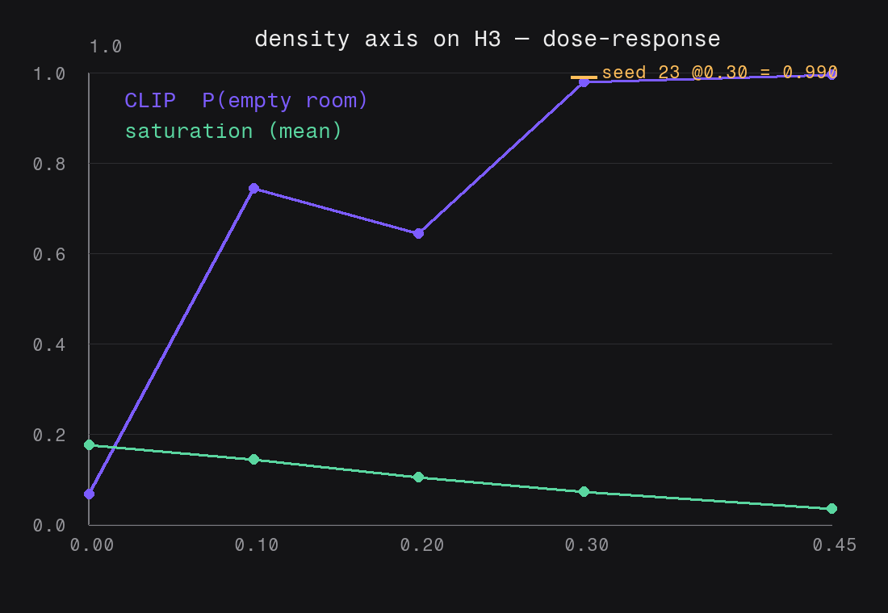
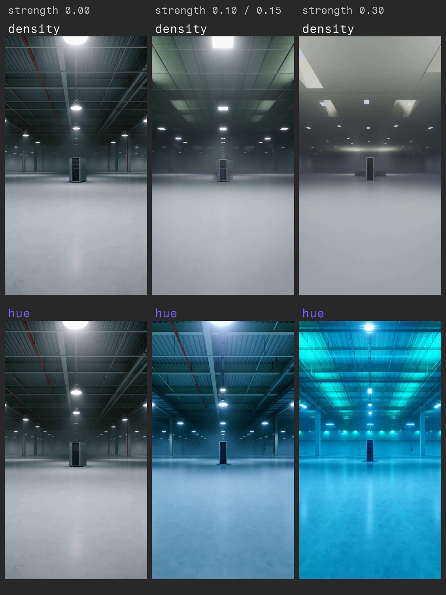
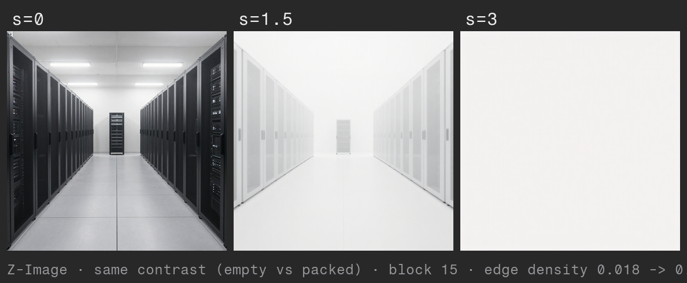

# Experiments

What we actually measured, and what we did not. Numbers here come from real runs on a
MiniMax H3 pod; the caveats are as important as the results.

## Setup

- **Model:** MiniMax H3 (video), block 20, hidden dim 5376, `fast` preset, 704×1280, 10.1 s.
- **Axis:** `density` — diff-in-means over two contrast prompts (*empty hall* vs *packed hall*),
  shipped as `example_axes/density.safetensors`.
- **Metric, per output:** the mid frame is scored by CLIP (`openai/clip-vit-base-patch32`) as
  `P("an empty room")` vs `P("a room packed with server racks and machinery")` → a single
  `CLIP empty` number. Plus plain image statistics — mean luminance, mean HSV saturation, and
  mean gradient magnitude ("edge density") — and mean-abs-difference vs the baseline frame.

## A. Dose-response (density axis)

Seed 11, block 20, base prompt; strength swept:

| strength | CLIP empty | saturation | edge density | diff vs base |
|---------:|-----------:|-----------:|-------------:|-------------:|
| 0.00 | 0.067 | 0.176 | 0.007 | — |
| 0.10 | 0.744 | 0.144 | 0.005 | 0.063 |
| 0.20 | 0.644 | 0.105 | 0.004 | 0.100 |
| 0.30 | 0.980 | 0.073 | 0.003 | 0.126 |
| 0.45 | 0.995 | 0.034 | 0.002 | 0.154 |

Replication — **seed 23 at 0.30 = 0.990** (vs 0.980 for seed 11): the effect reproduces.

**Reading.** Raising `strength` moves the frame toward "empty": the CLIP score climbs from
0.07 to ~1.0, saturation and edge density fall monotonically (fewer, flatter surfaces). The
trend is the result; individual points are noisy — note CLIP dips at 0.20 (0.644) after 0.10
(0.744).

**Honest caveat.** Past ~0.45 the frame begins to wash out (see [Limitations](../README.md#limitations)),
and at that point the "empty" reading conflates a real content change with the wash. The CLIP
probe is informative in the low-strength band and uninformative at the collapse.

## B. Is it a direction, or just magnitude? (hue control)

A second axis built from two prompts that differ **only in hue** (cool blue vs warm red),
same composition. If steering were just "more energy" (a magnitude effect), any axis would
look the same. It doesn't:

| axis | strength | CLIP empty | saturation | edge density |
|------|---------:|-----------:|-----------:|-------------:|
| density | 0.30 | 0.980 | **0.073** | 0.003 |
| hue | 0.30 | 0.990 | **0.917** | 0.009 |

At the same strength, density **drains** saturation (0.073) while hue **inflates** it (0.917),
and hue **preserves** edges (0.009 vs 0.003). The two directions push different, specific
properties — so the effect is directional, not a generic wash.

**Honest caveat.** The CLIP "empty" score also rises for the hue axis (0.990) even though the
content is preserved. That means the CLIP anchor is confounded at high strength (it tracks the
overall tonal shift, not just emptiness). We report it rather than hide it: **saturation and
edge density are the trustworthy signals here; CLIP is a useful low-strength probe, not a clean
high-strength one.**

## C. The same contrast in a second model (partial)

**Goal.** Capture the *same* contrast in a second model and ask whether the direction does the same
*kind* of thing — the first step toward portability.

**Done.** Z-Image (image, 30 layers, dim 3840) captured on the pod through the **job path**, layer 15,
identical *empty vs packed hall* prompts:

| Z-Image `density` | CLIP empty | luminance | saturation | edge density |
|--:|--:|--:|--:|--:|
| 0.00 | 0.000 | 0.496 | 0.065 | **0.018** |
| 1.50 | 0.011 | 0.891 | 0.005 | 0.004 |
| 3.00 | 0.951 | 0.947 | 0.012 | **0.001** |

**Reading.** Edge density — the content signal — falls monotonically in **both** models (H3: `0.007 → 0.002`; Z-Image: `0.018 → 0.001`). A "density" direction is not unique to H3's architecture.

**What this is NOT.** It is **not vector transfer**. A dim-5376 axis and a dim-3840 axis are different
objects; we compared the *effect of the same contrast in each model*, not a carried vector. Carrying
one model's axis into another's space is untested and needs an alignment.

**Caveat.** At Z-Image `s=3` the CLIP "empty" score (0.951) coincides with a near-white wash
(luminance 0.947), so that point is the wash, not a clean semantic reading — the same CLIP confound
noted in §B.

**Infra note.** A first attempt over SSH was killed by the pod's **idle watchdog** (SSH is not
counted as activity); the successful run went through the pod-manager's job path.

## Knobs not yet measured

Three controls are implemented and off — in their default state they reproduce every number above
exactly. None of them has been through a dose-response re-measure on the pod yet, so treat them as
untested knobs, not results:

- **`cond_only`** (`HelmCollect`, `HelmApply`; default `False`). Restricts collection and injection to
  the conditional batch items, leaving the unconditional pass untouched. This is the recommended
  setting for CFG models; the shipped axes and every table here were measured with it off.
- **Windowing** (`HelmApply` `start_percent` / `end_percent`; defaults `0.0` / `1.0`). Applies the axis
  only within a fraction of the sampling schedule. The default window spans the whole run, i.e. today's
  behavior.
- **Per-slider strength** (`app/run_helm.py --set axis=strength`). Sets a strength per `HelmApply` node
  instead of one global value. Exercised in unit tests only; not run against a live server.

A re-measure covering these is pending. Until it exists, the published band and figures stand only for
the default (off) settings.

## What this is not

- Not a claim that "density" or "mood" are *concepts*. They are low-level directions; the wash
  at high strength is the signature of pushing a sample off the model's manifold.
- Not a comparison against prompt-only or LoRA baselines. We have not measured those.
- One model (H3) for A and B, one contrast pair each.

## D. The probe: what a per-block profile tells us, and what it does not (Z-Image)

`HelmProbe` exists to answer "which block?" without a manual sweep: it reads *every* block over two
contrastive passes and ranks them by how far apart the two prompts sit, as
`||mu_pos - mu_neg|| / mean(||mu_pos||, ||mu_neg||)` — scale-free, so blocks compare to each other.
Run on Z-Image (30 layers, dim 3840, `NextDiT`, 6-step turbo graph, the *same* empty-vs-packed contrast
as §C):

| block | separation | cosine | \|mu\| | \|dmu\| |
|--:|--:|--:|--:|--:|
| 0 | 0.213 | 0.978 | 27 | 5.8 |
| 3 | 0.082 | 0.997 | 79 | 6.5 |
| 7 | 0.034 | 0.9995 | 230 | 7.8 |
| 9 | 0.033 | 0.9997 | 334 | 11.1 |
| 15 | 0.012 | 0.9999 | 964 | 11.5 |
| 18 | 0.011 | 0.9999 | 1212 | 13.5 |
| 29 | 0.085 | 0.996 | 1112 | 94 |

**Reading — this is data.** The separation is structural, not noise: it is largest at the first blocks,
falls monotonically into the middle (minimum at block 18), and rises again at the end. The two prompts
pull hardest at the extremes of the stack.

**What it does NOT do: pick the block.** The band *verified by rendering* is layers 9–21 (default 15,
`calibration.json`). The probe's highest-separation block inside the middle 50% is **7** — two blocks
below the band — and the naive global peak is **block 0**, which we already know destroys the frame.
Trust the global peak and you steer exactly where any perturbation wrecks the image.

**A strength estimator we built, measured, and removed.** From the H3 numbers (a perturbation ≈30% of the
block's activation norm across the verified band) we derived `strength ≈ 0.3 × |mu| / |dmu|`. On Z-Image
it returns **8.8** at the peak, against a verified band of **0.5–3** — an order of magnitude out. So the
estimator is not in the code: a number that wrong, under the word "suggested", is worse than no number.
The usable scale is model-specific; confirm it with the 1–2 renders `calibration.json` already asks for.

**Conclusion.** `HelmProbeReport` returns the separation profile and the middle-band peak *as a
measurement* — a starting point for a short sweep, not an auto-calibrator. **Caveat:** one model, one
contrast, one graph. H3 was not probed: the GPU window was shared with another workload, and the Z-Image
result already answers the question this feature was built on.
