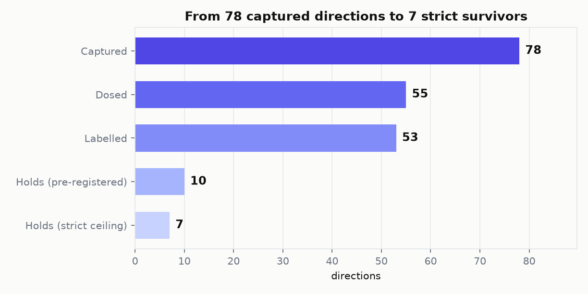
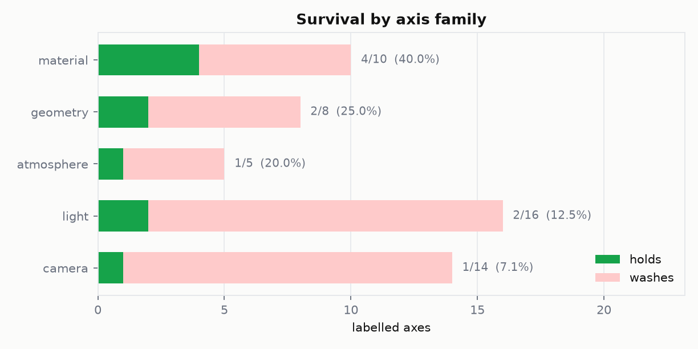
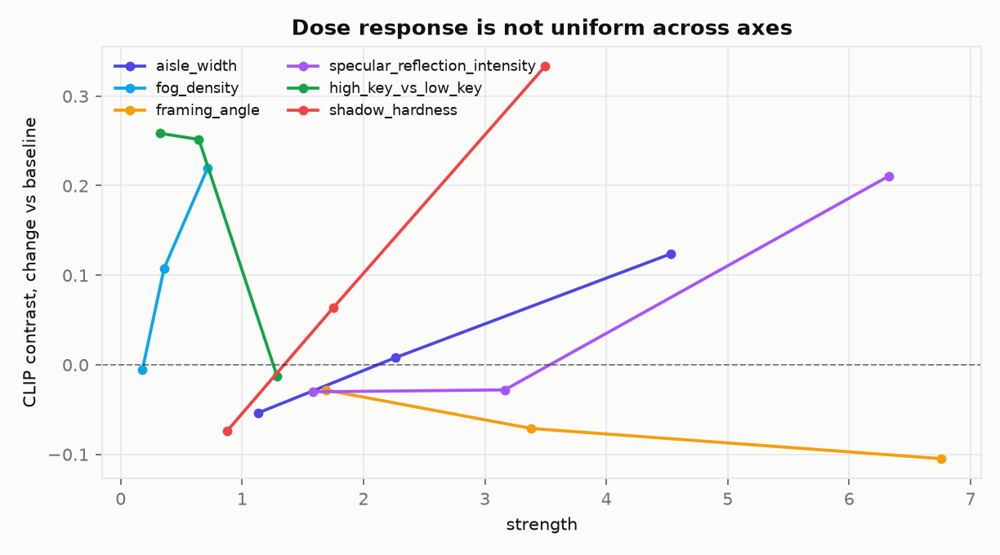
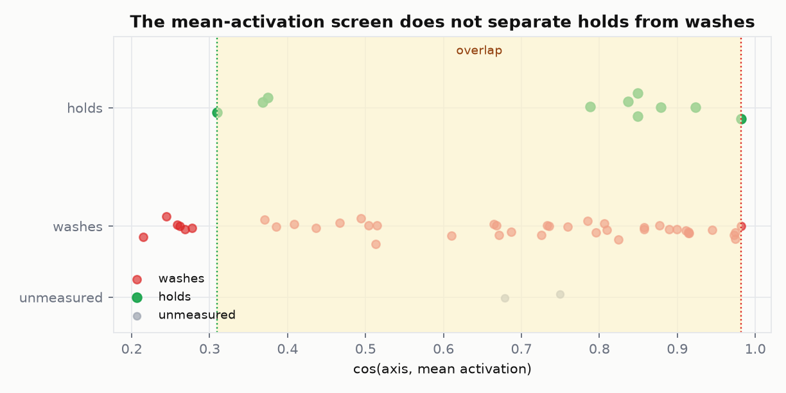
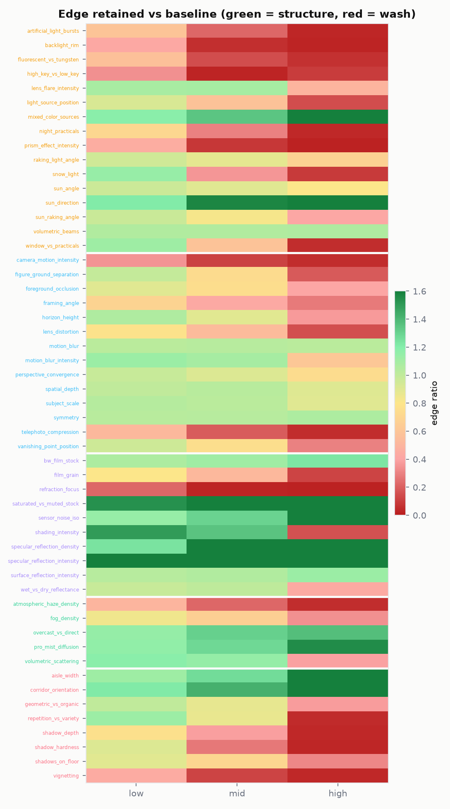
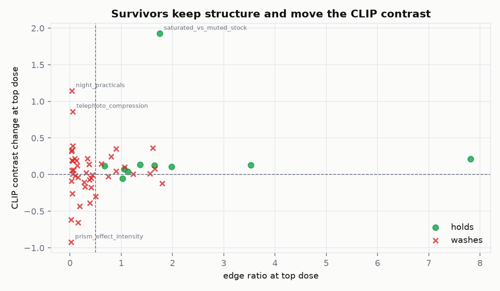
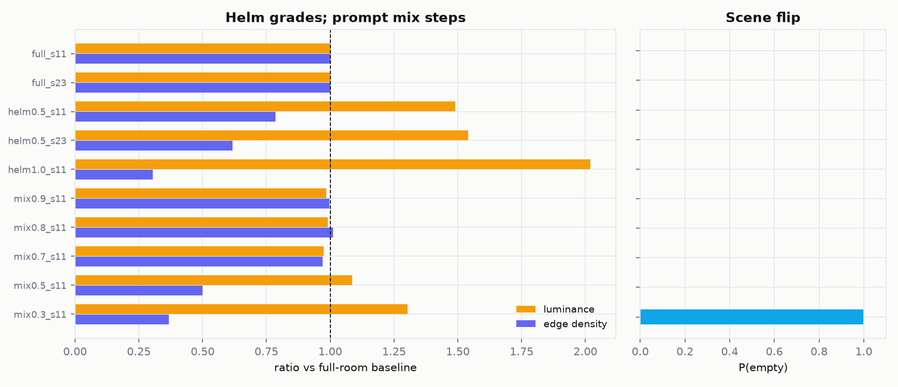
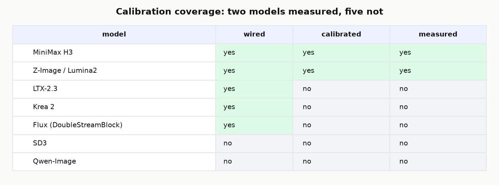
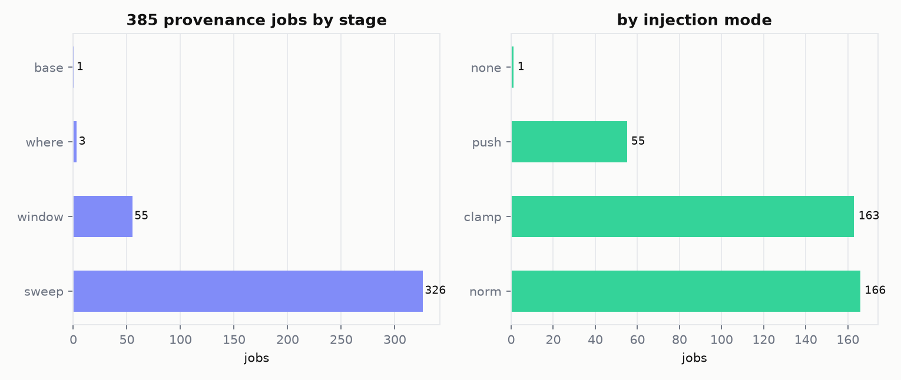

# Helm Study 01 — 78 directions, 55 dosed

**One line:** of 78 captured directions on Z-Image, 55 were dosed and 53 labelled; **10 hold** under the pre-registered criterion and **7** under a stricter quality ceiling. The rest wash out. This directory is the derived, reproducible layer behind that sentence.

> This is a study of the evidence already in [`docs/EXPERIMENTS.md`](../docs/EXPERIMENTS.md), [`docs/data/`](../docs/data) and the 385-job provenance index. It is not a new claim. The JSON files are the source of truth; everything here is generated by [`src/build_study.py`](src/build_study.py).

## Headline

| stage | n |
|---|---:|
| captured | 78 |
| dosed | 55 |
| labelled | 53 |
| holds, pre-registered | **10** (18.9%) |
| holds, strict ceiling | **7** (13.2%) |
| washes | 43 |
| unmeasured | 2 |



The funnel is the whole story: the interesting number is not how many directions we captured, it is how few survive a dose. `holds` means the CLIP contrast moved monotonically, edge density stayed at least 50% of baseline, and luminance stayed within 0.20 of baseline at every dose. `strict` adds a post-hoc ceiling (saturation <= 0.5, edge <= 2x baseline) and is reported next to the pre-registered label, not instead of it.

## Survival by family

| family | labelled | holds | washes | hold rate | strict holds | strict rate |
| --- | --- | --- | --- | --- | --- | --- |
| light | 16 | 2 | 14 | 12.5% | 2 | 12.5% |
| camera | 14 | 1 | 13 | 7.1% | 1 | 7.1% |
| material | 10 | 4 | 6 | 40.0% | 1 | 10.0% |
| atmosphere | 5 | 1 | 4 | 20.0% | 1 | 20.0% |
| geometry | 8 | 2 | 6 | 25.0% | 2 | 25.0% |

**Observation:** the best family here is **material** (4/10, 40.0%); the worst is **camera** (1/14, 7.1%). Under the strict ceiling material falls to 1/10, so the family ranking is not stable across criteria. This is a description of this 55-axis set, not a law: the families are curated by hand and the n per family is small.



## The survivors

| axis | family | ΔCLIP | edge × | lum Δ | cos | top push | strict |
| --- | --- | --- | --- | --- | --- | --- | --- |
| saturated_vs_muted_stock | material | 1.925 | 1.75 | 0.17 | 0.310 | 1.94 |  |
| specular_reflection_intensity | material | 0.211 | 7.82 | 0.01 | 0.368 | 6.33 |  |
| overcast_vs_direct | atmosphere | 0.134 | 1.37 | 0.16 | 0.836 | 2.39 | yes |
| specular_reflection_density | material | 0.130 | 3.53 | 0.04 | 0.849 | 4.44 |  |
| aisle_width | geometry | 0.124 | 1.65 | 0.20 | 0.878 | 4.53 | yes |
| raking_light_angle | light | 0.120 | 0.67 | 0.20 | 0.788 | 2.81 | yes |
| corridor_orientation | geometry | 0.110 | 1.98 | 0.12 | 0.374 | 9.55 | yes |
| volumetric_beams | light | 0.076 | 1.06 | 0.05 | 0.923 | 2.01 | yes |
| surface_reflection_intensity | material | 0.039 | 1.13 | 0.08 | 0.849 | 3.04 | yes |
| motion_blur | camera | -0.054 | 1.02 | 0.05 | 0.982 | 0.49 | yes |



**Observation:** several survivors are already at the edge of the ceiling at their top push dose. The `strict` column is empty for the three axes whose top push dose crosses the post-hoc saturation/edge limit (`saturated_vs_muted_stock`, `specular_reflection_density`, `specular_reflection_intensity`); those three are strict washes, not strict holds. The primary labels are unchanged; use the `safe_max` in the axis header, not the top push dose, as the production band. A hold is also not a promise of a large effect: `motion_blur` holds the criterion with a ΔCLIP of -0.054.

## The screen that failed



**Observation:** cosine alignment with the mean activation does **not** separate holds from washes. The lowest survivor is at 0.310 and the highest wash is at 0.982; every hold sits inside the wash range. At n=23 the same metric looked like a screen; at n=78 it is a small-sample artifact. The numbers stay, the story is in [`NEGATIVE-RESULTS.md`](NEGATIVE-RESULTS.md).

## Where the wash happens



**Observation:** the wash is not evenly distributed. Some axes lose edge early; others keep structure to the top push dose and fail on saturation or luminance instead. A wash can also be a monotonicity failure with no edge collapse at all (`mixed_color_sources`, `symmetry`, `sun_angle`, `subject_scale`, `pro_mist_diffusion`); those have an empty `onset`. The `onset` column in [`data/axes.csv`](data/axes.csv) is the first strength that crosses any of the three structural failure conditions, so it is not a complete label on its own.

## Effect size



**Observation:** the axes that hold are not simply the ones with the largest CLIP move. A useful direction keeps edge ratio above 0.5 and still moves the contrast; a large ΔCLIP with a collapsed edge is the wash, not a stronger edit.

## Helm is not a prompt mixer



| variant | lum × | edge × | P(empty) |
| --- | --- | --- | --- |
| full_s11 | 1.000 | 1.000 | 0.0000 |
| full_s23 | 1.000 | 1.000 | 0.0000 |
| helm0.5_s11 | 1.489 | 0.786 | 0.0000 |
| helm0.5_s23 | 1.541 | 0.618 | 0.0000 |
| helm1.0_s11 | 2.019 | 0.305 | 0.0000 |
| mix0.9_s11 | 0.984 | 0.996 | 0.0000 |
| mix0.8_s11 | 0.991 | 1.011 | 0.0000 |
| mix0.7_s11 | 0.975 | 0.970 | 0.0000 |
| mix0.5_s11 | 1.085 | 0.500 | 0.0000 |
| mix0.3_s11 | 1.303 | 0.368 | 0.9980 |

**Observation:** on this benchmark Helm at 0.5 keeps the scene (P(packed) = 1.0) and grades luminance and detail; the prompt mix is a no-op from 0.9 to 0.7 and flips the scene at 0.3. The fair design starts both methods from the same full-room prompt. One model, one contrast, two seeds; a LoRA baseline is still not measured.

## Model coverage

| model | module | blocks | dim | default block | band | strength | status |
| --- | --- | --- | --- | --- | --- | --- | --- |
| MiniMax H3 | blocks | 50 | 5376 | 20 | 15-35 | 0.01-0.30 | measured |
| Z-Image / Lumina2 | layers | 30 | 3840 | 15 | 9-21 | 0.50-3.00 | measured |
| LTX-2.3 | transformer_blocks |  |  | 20 |  |  | hook ready, untested |
| Krea 2 | blocks |  |  |  |  |  | wired, no calibration |
| Flux (DoubleStreamBlock) | double_blocks |  |  |  |  |  | tuple slot declared, no dose |
| SD3 | joint_blocks |  |  |  |  |  | refused until measured |
| Qwen-Image | transformer_blocks |  |  |  |  |  | refused until measured |



**Observation:** only H3 and Z-Image have a measured band. LTX is wired but untested; Krea 2 has templates but no calibration entry; Flux is declared but not dosed; SD3 and Qwen-Image are refused until measured. No Helm claim rests on the unmeasured models.

## Provenance

The `385` jobs behind the 2026-10-19 window are indexed with `sha256`, graph hash and sidecar path: [`data/provenance.csv`](data/provenance.csv). By stage: sweep 326, window 55, where 3, base 1. By mode: norm 166, clamp 163, push 55, none 1. The summary is [`data/provenance_summary.csv`](data/provenance_summary.csv); the original is [`docs/data/evolution-20261019/renders.jsonl`](../docs/data/evolution-20261019/renders.jsonl).



## The atlas

[`atlas/index.html`](atlas/index.html) is the same 55 axes as a visual sheet: three norm strengths plus the single push render available (middle strength), filterable by family and outcome. The card metrics use the top push dose; the fourth panel is the middle-strength push render. It works from `file://`; the thumbnails are derived from the media archive and are not required to rebuild the tables.

## Reproduce

```bash
make -C study
# or
uv run --no-project --with matplotlib --with pillow --with numpy \
  python study/src/build_study.py
```

The CSVs and charts need only the JSON in `docs/data/`. The atlas thumbnails additionally need the external media archive at `~/HAL-archive/helm-videos/build/v38-intake/z19/2026-10-19/evo/`; if it is missing the build still writes every table and chart and the atlas falls back to placeholders.

## Data and licence

- [`data/axes.csv`](data/axes.csv) — one row per captured direction (78).
- [`data/labels_long.csv`](data/labels_long.csv) — tidy rows for baseline/push/norm/clamp (544).
- [`data/doses.csv`](data/doses.csv) — the 163 measured dose points.
- [`data/window.csv`](data/window.csv) — the 55 step-window points.
- [`data/bench_prompt_mix.csv`](data/bench_prompt_mix.csv) — the fair prompt-mix benchmark.
- [`data/provenance.csv`](data/provenance.csv) — the 385 jobs.

Code MIT; labels and metadata CC BY 4.0. The renders themselves live outside git; see [`DATASET.md`](DATASET.md) for the data card and exclusions.

## Limitations

- One model (Z-Image), one contrast pair, seed 11, three strengths per axis; the H3 dose-response is separate and smaller.
- CLIP is a useful low-strength probe and a confounded high-strength one (it tracks the tonal shift, not only the content).
- The families are curated, not measured; the per-family rates are descriptive.
- `strict_push` is post-hoc; the pre-registered labels are `labels.push`.
- The mask localises the injection, not the visible effect: attention spreads the change outside the mask.
- The atlas thumbnails are 260 px crops for browsing, not evidence.

---

Built 2026-10-27 06:55 UTC from `docs/data/axis-labels.json`, `docs/data/zimage-78-axes.json`, `docs/data/zimage-dose-response.json`, `docs/data/bench2-vs-prompt-mix.json`, `docs/data/evolution-20261019/renders.jsonl` and `calibration.json`.
